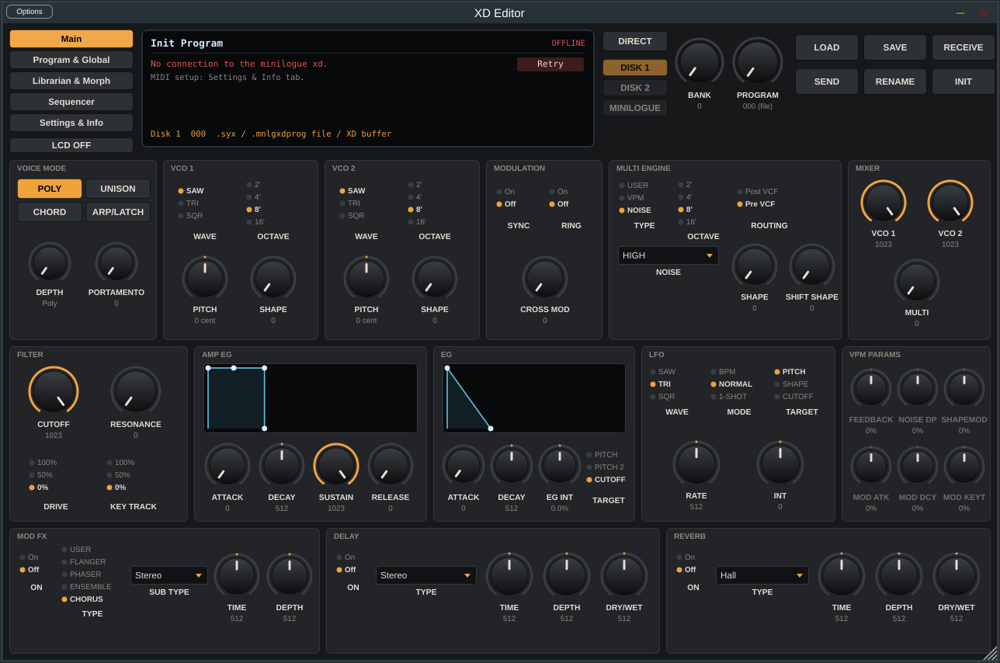

# XD Editor — editor & librarian for the Korg minilogue xd (VST3 / AU / standalone)

An open-source editor and librarian for the **Korg minilogue xd**, recreating the feature set of the
discontinued "Korg Minilogue XD" Ctrlr panel by Sunny Synths (v2.4) as a native JUCE plugin.
It works like the hardware editors from synth makers (e.g. Moog's plugins): **the patch is saved with your DAW
project and sent back to the synth when the project is opened**, and you get a full librarian on top.



## Features

| From the original panel | In XD Editor |
|---|---|
| Every program parameter, two-way editing (CC/NRPN) | ✔ 10-bit CCs (CC63 + CC), 7/8/10-bit NRPNs, context CCs (Multi shape/select, Mod FX sub type) |
| Parameters without CC ("light green") + small Send buttons | ✔ plus optional **auto-send** of the program dump 250 ms after a change |
| LCD: name, description, CC/NRPN number, current and saved value | ✔ (plus LCD OFF) |
| ADSR / AD envelope graphs editable with the mouse | ✔ |
| Direct mode, Source (Disk 1 / Disk 2 / Minilogue), Bank, Program, position 000 = file | ✔ |
| Load / Save / Receive / Send / Rename / Init | ✔ (Init keeps the author) |
| .syx, .mnlgxdprog, .mnlgxdlib (read), .prog_bin files | ✔ — **.mnlgxdlib can also be written** |
| Description, author, category, save date (`_AddInfo`) | ✔ (`name_AddInfo.xml` next to .syx files; inside prog_info for .mnlgxdprog) |
| Global parameters (Request / Send) | ✔ |
| Librarian: 3 banks × 500, load/save/init/receive/send/clear/export list | ✔ |
| Program actions: load, init, insert file, save to file, buffer → slot, move, copy, multi-copy (as-is / collated), swap, comparisons | ✔ |
| Clean dump (`_CleanDump.syx`), BankAutoSave, `*` on unsaved banks | ✔ |
| Morphing with section locks, Morph 0% / 100%, CC 100 | ✔ plus a **"Morph" automation parameter** |
| Note / Motion sequencer view | ✔ (read-only, as in the original) |
| USER module names (osc / mod fx / delay / reverb) | ✔ |
| Program information display and export (7 modes) | ✔ |
| Confirmation switches, save mode, transfer speed, zoom with memory | ✔ |
| Device Inquiry + retry button | ✔ (the MIDI channel is picked up automatically from the synth's reply) |

Values are shown the way the synth shows them: Voice Mode Depth as Duo / detune / chord / arp pattern
depending on the voice mode, LFO rate as a note value in BPM mode, pitch in cents, and so on.

## Download (Windows / macOS)

Pre-built binaries are produced by GitHub Actions on every push:

* Go to the **Actions** tab → latest **Build** run → **Artifacts**:
  `XD-Editor-Windows` (VST3 + .exe) and `XD-Editor-macOS` (VST3 + AU + .app, universal arm64/x86_64).
* Tagged versions (`v1.0.0`, …) are also published under **Releases** as .zip files.

## Installation

**Windows:** copy the `XD Editor.vst3` folder to `C:\Program Files\Common Files\VST3\`.
`XD Editor.exe` is the standalone version. The build is not code-signed, so SmartScreen may warn you —
choose *More info → Run anyway*.

**macOS:** copy `XD Editor.vst3` to `~/Library/Audio/Plug-Ins/VST3/` and `XD Editor.component` to
`~/Library/Audio/Plug-Ins/Components/` (Logic uses the AU). The build is not notarised, so remove the
quarantine flag once:

```
xattr -dr com.apple.quarantine ~/Library/Audio/Plug-Ins/VST3/"XD Editor.vst3" ~/Library/Audio/Plug-Ins/Components/"XD Editor.component"
```

## MIDI setup (Settings & Info tab)

* **Input:** `minilogue xd KBD/KNOB` (USB) or the MIDI DIN port. **Output:** `minilogue xd SOUND`.
  With the generic Windows driver the ports may be called `minilogue xd` / `MIDIIN2 (minilogue xd)` —
  pick the one on which knob movements arrive.
* The **MIDI channel** is set automatically from the Device Inquiry reply (the synth's global channel).
* **Output route:**
  * *MIDI device port* (default) — the plugin talks to the synth directly, so SysEx works in every DAW
    (including Ableton, which does not pass SysEx from plugins). Notes from the DAW track are forwarded to the
    synth ("Thru: host notes → synth"). Disable the same port for your DAW tracks to avoid doubled notes
    (on Windows a MIDI port can only be opened by one application at a time).
  * *via the DAW* — everything goes to the plugin's MIDI output and the DAW routes it to the synth.
  * *both*.
* If the synth's CCs reach the DAW track, enable "Host MIDI in = synth feedback" so turning knobs on the synth
  updates the panel and can be recorded as automation.
* Close other MIDI tools (MIDI-OX, Korg Librarian) before starting XD Editor on Windows.

## Working in a DAW

XD Editor is an **audio effect** (VST3 "Fx", AU "MusicEffect"): put it as an insert on the audio track that
receives the minilogue xd's audio, like any EQ or compressor. The audio passes through unchanged; the plugin
talks to the synth over its own MIDI ports, so your DAW's MIDI track can keep sending notes to the synth as usual.

* Each instance stores in the project: the current patch (all 1024 bytes including the sequence), the "saved"
  version (for comparisons), description/author, bank file paths, panel state and morph locks.
* When the project is opened the patch is sent to the synth's edit buffer (~0.7 s after loading) —
  option **Send patch on project load**. **Send patch when editor opens** sends a track's patch when you open
  its plugin window (handy with several tracks using one synth).
* DAW presets (Cubase .vstpreset, Reaper, Studio One, Ableton, Logic .aupreset, track presets) work because they
  store the same state.
* All ~120 parameters plus "Morph" can be automated. Parameter IDs are names, not numbers, so future versions
  won't break existing automation.
* With several instances, data coming from the synth goes to the instance you last worked with.

## Building from source

Requirements: CMake ≥ 3.22 and a C++17 compiler (Visual Studio 2022 / Xcode 15 / GCC 11+). JUCE 8.0.4 is
downloaded automatically (or point to your own checkout with `-DJUCE_DIR=...`).

```
cmake -S . -B build -DCMAKE_BUILD_TYPE=Release
cmake --build build --config Release
```

Output: `build/XDEditor_artefacts/Release/{VST3,AU,Standalone}`.
Tests: `XDCoreTests` (data format, files, morphing) and `XDProcessorTests` (MIDI, DAW state, bank transfer
against a simulated synth). `XDCoreTests <file>` prints a summary of any .syx / .mnlgxdlib bank.
On Linux you need: `libasound2-dev libfreetype-dev libfontconfig1-dev libx11-dev libxrandr-dev libxinerama-dev libxcursor-dev libxext-dev libgl1-mesa-dev`.

## Status

* The CC/NRPN map, value lists (joystick/CV targets, micro tunings, arp rates, arp patterns/chords, motion
  parameter IDs) and the USER SLOT STATUS format follow the official
  **KORG minilogue xd MIDI Implementation rev. 1.01**.
* The data format is verified against a real 500-program bank exported from Korg Sound Librarian
  (names, voice modes, effects, motion sequences; out-of-range values found in real patches are preserved).
* Confirmed on hardware: 10-bit knob values are sent as CC63 (low 3 bits) followed by the parameter CC.
* Validated with **pluginval (strictness 7, including GUI tests)**; builds without warnings on GCC and Clang.

**Not yet tested end-to-end with the synth** — reports are very welcome (open an Issue), especially for:
bank receive/send and writing to slots (Program Data Dump 0x4C), global parameters, USER module names.

## Project layout

```
Source/core/            program format (1024 bytes), parameter table, SysEx, files, reports, morphing (no GUI)
Source/MidiEngine       shared MIDI ports, CC/NRPN parser
Source/PluginProcessor  parameters/automation, send/receive, transfers, DAW project state
Source/Librarian        bank operations
Source/gui/             look & feel, controls, the five tabs
Tests/                  unit and integration tests
```

Most hardware quirks are a one-line change in the parameter table in `Source/core/Params.cpp`.

## License

XD Editor is free software released under the **GNU AGPLv3** (see `LICENSE`), the same license as the JUCE
framework it is built on when used without a commercial JUCE license.

"Korg" and "minilogue" are trademarks of Korg Inc. This project is not affiliated with or endorsed by Korg.
Thanks to Sunny Synths for the original Ctrlr panel and its documentation.
